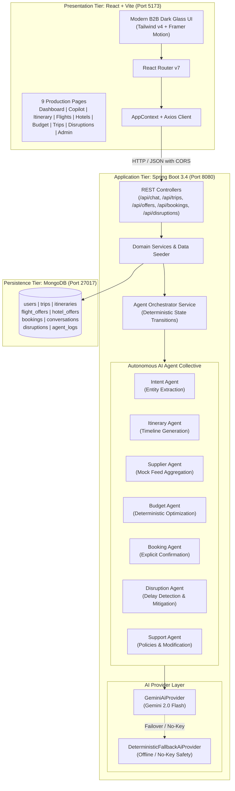
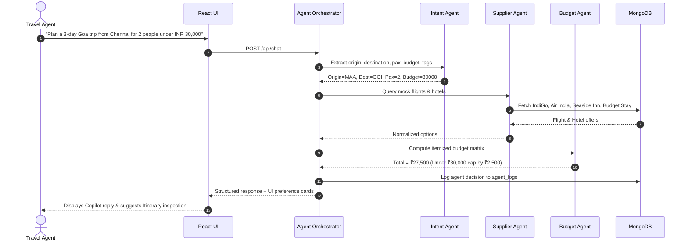

# VoyagePilot AI — System Architecture

VoyagePilot AI is an enterprise-grade Virtual Travel Agent Copilot built for **TBO VOYAGEHACK 4.0**.

## 1. High-Level Architecture Diagram

---

## 2. Multi-Agent Orchestration Sequence

